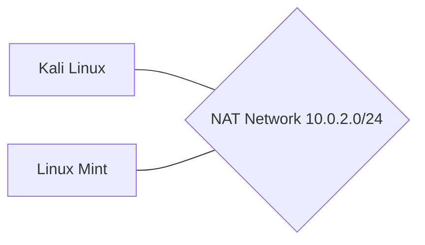

# Cybersecurity Lab

Hands-on security practice supporting CompTIA Security+ SY0-701 and a career in GRC, cloud security, and detection.

## Environment
- Host: Windows 10, VirtualBox
- Kali Linux (attacker/analysis) and Linux Mint (target) on an isolated NAT Network

All testing is done only against my own VMs or authorized training platforms.

## Labs
See [LAB-LOG.md](LAB-LOG.md).