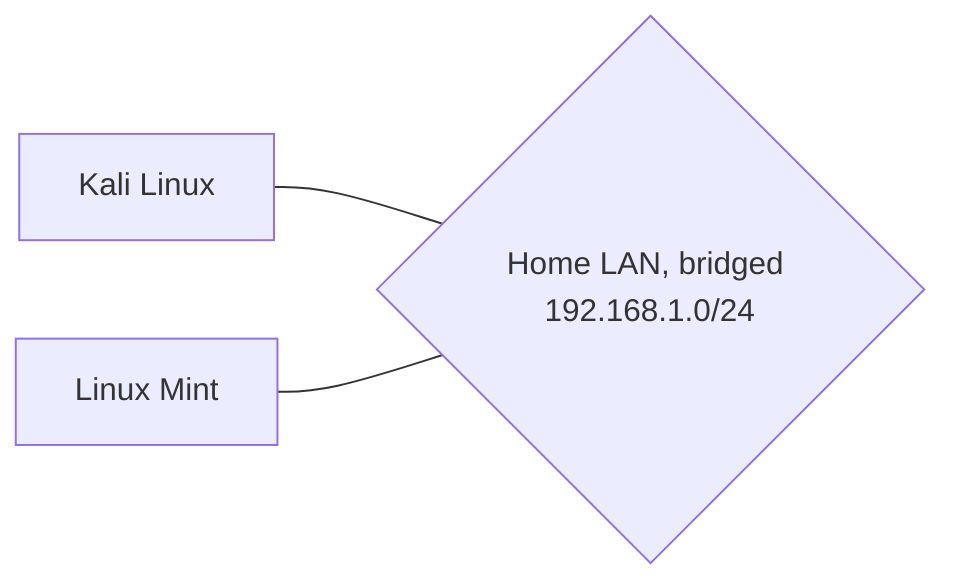

# Cybersecurity Lab

Hands-on security practice supporting CompTIA Security+ SY0-701 and a career in GRC, cloud security, and detection.

## Goals
- Build hands-on practice that supports Security+ SY0-701
- Document each lab (setup, steps, evidence, lessons) so it can be reviewed on GitHub
- Build toward GRC, cloud security, and detection work

## Environment
- Host: Windows 10, VirtualBox
- Kali Linux (attacker/analysis) and Linux Mint (target), both on a bridged adapter on the home LAN (192.168.1.0/24)



All testing is done only against my own VMs or authorized training platforms.

## Repo layout
```
cybersecurity-lab/
  docs/          lab write-ups, lab log, write-up template
  screenshots/   evidence for each lab (see screenshots/README.md)
  LICENSE
  README.md
```

## Labs
| # | Lab | Write-up |
|---|---|---|
| 00 | Environment setup | [docs/00-environment-setup.md](docs/00-environment-setup.md) |

Running log: [docs/LAB-LOG.md](docs/LAB-LOG.md). New labs start from [docs/writeup-template.md](docs/writeup-template.md).

## What I'd do next
- Add the next labs using the write-up template

## License
MIT. See [LICENSE](LICENSE).