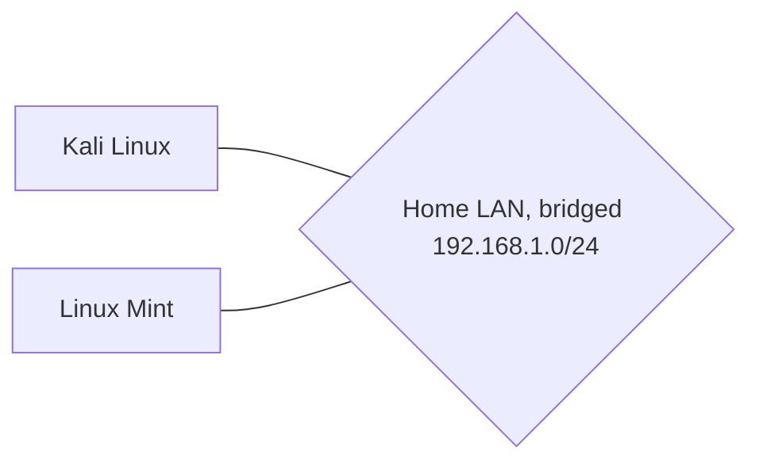

# Lab 00: Environment Setup

## Objective
Build a small practice network with an attacker VM and a target VM, so later labs can be run safely against my own machines.

## Environment
- Host: Windows 10 with VirtualBox
- Kali Linux VM (attacker / analysis), `192.168.1.247`
- Linux Mint VM (target), `192.168.1.207`
- Both VMs on a **Bridged Adapter**, sharing the home LAN `192.168.1.0/24`

## Steps
1. Installed VirtualBox on the Windows 10 host.
2. Created the Kali Linux and Linux Mint virtual machines.
3. Put both VMs on a VirtualBox **NAT Network** first, so they could reach each other.
4. Found that NAT Network does not let the VMs reach the Windows host. Changed both VMs to **Bridged Adapter** (VM Settings > Network > Attached to: Bridged Adapter).
5. Verified connectivity: checked each VM's address with `ip a`, then confirmed Kali and Mint could ping each other.

Evidence: `screenshots/01-github-repo.png` (repo layout and network diagram) and `screenshots/02-virtualbox-manager.png` (VirtualBox Manager showing the lab VMs).

## Findings
- NAT Network gives VM-to-VM connectivity but no route to the host.
- A Bridged Adapter gives each VM its own address on the home network, so the VMs can reach each other and the host.

## Defensive Takeaways
- A bridged attacker VM puts attack tooling on a real network. Keep all testing limited to my own VMs or authorized training platforms.
- Network placement matters: the choice between NAT, NAT Network and bridged decides what can talk to what.

## Security+ SY0-701 Mapping
- Domain 3.0 Security Architecture: network segmentation, virtualization, and network placement of systems.
- Domain 4.0 Security Operations: building a safe practice environment for later detection work.

## Lessons Learned
- Plan the network mode before building the lab. The switch from NAT Network to Bridged was needed once Splunk on the host had to receive logs from the VMs (see the `splunk-soc-lab` repo).
- Record each VM's address as soon as it is set up, since later labs depend on them.
